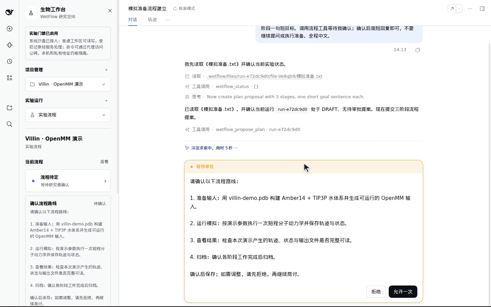
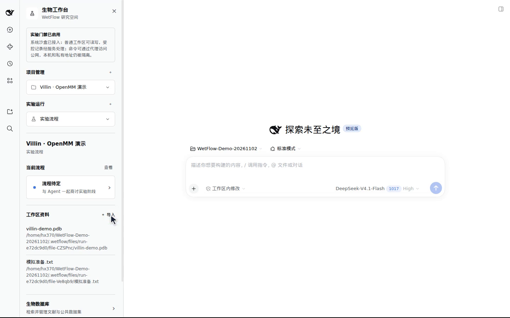
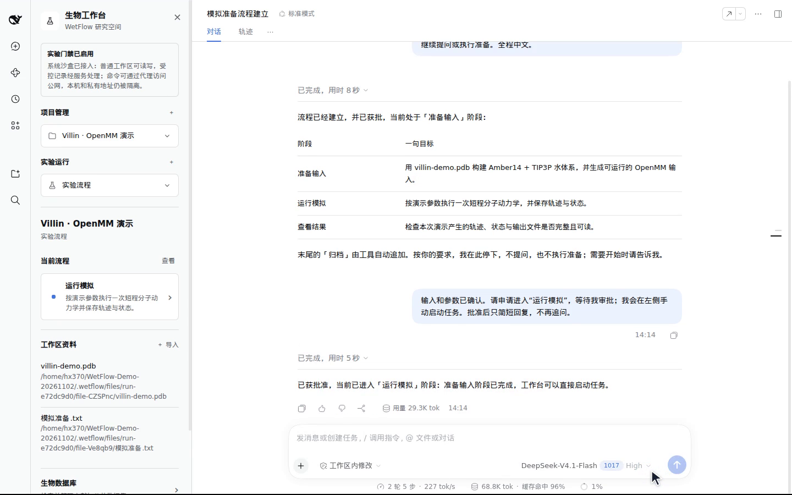
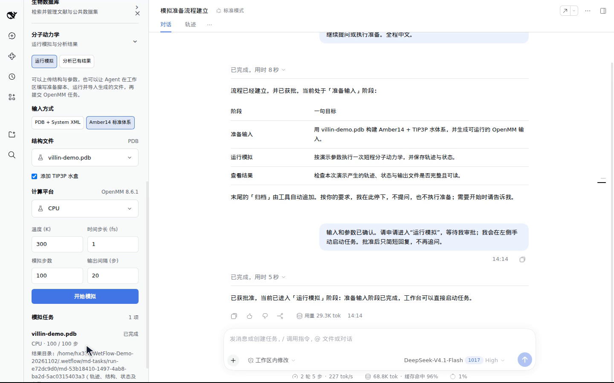
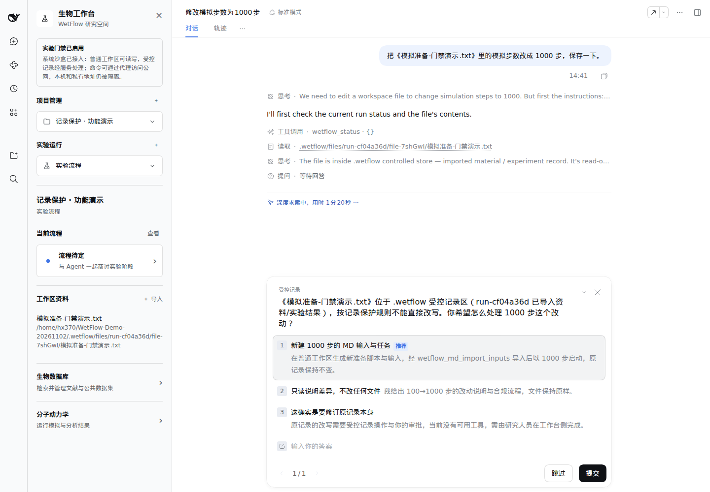

# DSH–WetFlow

DSH–WetFlow 是一个面向生物研究的 DeepSeek Harness 社区插件。它把项目资料、实验流程、测量记录、研究者审批和分子动力学工具放进同一工作台，Agent 也能在对话中使用这些能力。

这是预览版本，当前验证环境为 **DSH 0.2.1-rc.5、Linux／WSL、Node.js 22.22、Python 3.12、Bubblewrap 和 OpenMM 8.6.1 CPU**。原生 Windows 与 macOS 尚未适配。项目独立于 DeepSeek 官方维护。

## 演示

从导入项目资料、提出流程方案和人工审批，到运行 OpenMM 并保存结果，下面的视频展示了工作台的实际操作。

[观看演示视频（约 62 秒，60 帧，无字幕）](https://github.com/c4i890/dsh-wetflow/releases/download/v0.1.0-alpha.1/dsh-wetflow-demo.mp4) · [下载全部示例图与视频](https://github.com/c4i890/dsh-wetflow/releases/download/v0.1.0-alpha.1/dsh-wetflow-demo-media.zip)

[](https://github.com/c4i890/dsh-wetflow/releases/download/v0.1.0-alpha.1/dsh-wetflow-demo.mp4)

研究者确认流程方案后，Agent 才能按流程继续推进。视频中的 OpenMM 任务使用 100 步短模拟，展示体系准备、运行与结果保存。

<details>
<summary>查看其他示例图</summary>

**工作台与项目资料**



**审批后推进阶段**



**OpenMM 任务完成**



**插件保护你的重要资料**

插件将导入资料标记为受保护记录。这个示例中，Agent 收到修改请求后保留了原文件，并提出后续处理选项。



</details>

## 安装

安装 Node.js、pnpm 和 DSH 0.2.1-rc.5，并在 Linux 或 WSL 中安装 `bubblewrap` 与 Python 3.11 以上版本。Ubuntu 示例：

```bash
sudo apt install bubblewrap python3-venv
npm install -g pnpm @deepseek-ai/dsh@0.2.1-rc.5
```

从 [Releases](https://github.com/c4i890/dsh-wetflow/releases) 下载安装包，在文件所在目录运行：

```bash
dsh plugin --profile web add ./dsh-wetflow-0.1.0-alpha.1.tgz
dsh web
```

打开 DSH 后，从左侧进入生物工作台，选择 DSH 工作区并创建或选择项目。按 DSH 显示的认证链接进入页面。

如需运行分子动力学，创建 Python 环境并指定其解释器：

```bash
python3 -m venv "$HOME/.local/share/dsh-wetflow/venv"
"$HOME/.local/share/dsh-wetflow/venv/bin/python" -m pip install openmm==8.6.1 numpy==2.5.3
export DSH_WETFLOW_MD_PYTHON="$HOME/.local/share/dsh-wetflow/venv/bin/python"
dsh web
```

GPU 平台需要自行安装相应的 OpenMM 和驱动，当前发布包只验证过 CPU。系统门禁需要可运行的 Bubblewrap 用户命名空间；若系统不支持，普通命令会停止执行并在工作台提示。可通过 `DSH_WETFLOW_BWRAP` 指定 Bubblewrap 路径。

## 使用

在工作区导入实验资料后，可以让 Agent 检索来源、整理方案、提出流程推进申请或提交测量。实验阶段变更和测量写入需要研究者确认。文献数据与实际测量应分别记录。

MD 支持导入 PDB 和 OpenMM System XML，或使用 Amber14 准备标准体系。Agent 也可以在普通工作区编辑、运行准备脚本，再将生成文件和脚本副本导入当前实验运行。模拟结果包含结构、轨迹、状态与参数；常规 MD 不模拟化学成键。PMA–DA 投料比工具用于比较已保存的汇总报告。

命令在独立沙盒中运行，可读写普通工作区；受控记录由服务管理。公网 HTTP(S) 可经代理访问，直接访问本机及私有网络受限。

## 从源码构建与测试

源码包解压后，在根目录运行：

```bash
npm ci --ignore-scripts
npm run build
npm run doctor
npm test
```

构建使用 `wetflow/package-lock.json` 安装并构建内嵌 WetFlow；MD 测试还需要上面的 Python 环境。`npm run release` 在 `release/` 生成安装包和源码包。插件不包含 API 密钥，模型账号在 DSH 中自行配置。

代码采用 Apache-2.0；内嵌 WetFlow 保留其许可证。第三方依赖及 DSH 使用各自许可证，见 [NOTICE](NOTICE)。
